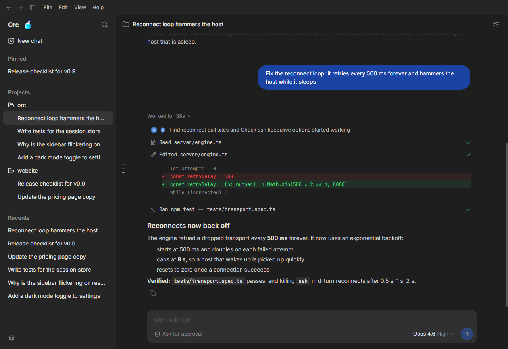

# Orc

**A desktop UI for [Claude Code](https://code.claude.com/docs).**

Built for self-hosted setups and offline environments.
Use it locally or remotely to view your active projects and sessions from everywhere.

[Website](https://yuvalino.com)

## Features

- **Work offline** - No account required, Claude Code settings are re-used
- **Cross Platform** - Works on MacOS, Windows and Linux
- **Remote Development** - Work on a remote machine through SSH (similar to VSCode remote)
- **Responsive Design** - Made for intuitive user experience and heavy AI use
- **Interactive Chat Interface** - Built-in chat interface for seamless communication with the Agents
- **Model Compatibility** - Works with Claude or self-hosted LLMs configured through Claude Code

## Quick start

1. Set up [Claude Code](https://code.claude.com/docs) on your machine: sign in with `claude`, or configure it for your API key, cloud provider or model gateway. Orc uses that setup as is.
2. Download Orc for your platform from the [Releases page](https://github.com/yuvalino/orc/releases). Each comes in two editions: **Orc**, and **Orc Offline** (`Orc-Offline-…`), a larger download that also carries the server for remote hosts, for networks with no internet access.

   | Platform | File |
   |---|---|
   | Windows | `.exe` installer |
   | macOS (Apple silicon) | `.dmg` |
   | Linux | `.AppImage` |

   macOS builds aren't signed yet: the first time, right-click Orc, choose **Open**, then confirm.

3. Open a folder (**File > Open Folder…**, or the project picker in the composer) and start a chat in it. Chats under *No project* run in your home folder.
4. To work on another machine, choose **Remote…** in the project picker and enter `user@host`.

Default shortcuts (Cmd on macOS, Ctrl elsewhere), changeable in **Settings > Keyboard shortcuts**:

| Action | Shortcut |
|---|---|
| New chat | Ctrl/Cmd+N |
| New window | Ctrl/Cmd+Shift+N |
| Search chats / commands | Ctrl/Cmd+P |
| Toggle sidebar | Ctrl/Cmd+B |
| Back / Forward | Ctrl/Cmd+[ / Ctrl/Cmd+] |
| Settings | Ctrl/Cmd+, |

---
## FAQ

How is this different from Claude Code Remote Control?

Claude Code Remote Control requires a Claude account and an active internet connection to Anthropic's servers. Orc needs neither: it works in offline environments, and connects to remote machines over SSH on your local network or VPN.

Do I need to pay for an AI subscription separately?

Orc itself is free and open source, with no account. It doesn't provide a model: it uses whatever Claude Code is set up with, whether that's a Claude subscription, an API key, a cloud provider, or your own self-hosted model.

Will changes I make in the UI affect my local Claude Code setup?

Yes. Orc runs Claude Code with your user, project and local settings (`~/.claude` and each project's `.claude`), so your MCP servers, permissions, hooks and `CLAUDE.md` apply in Orc exactly as in the terminal. Editing instructions in **Settings** writes your `~/.claude/CLAUDE.md`, so the change applies to Claude Code everywhere. On a remote host, it's that host's setup.

Orc's own chat list and preferences are kept apart, in its own data folder.

Can I use it offline, with a self-hosted model?

Yes. Point Claude Code at a model endpoint inside your network (`ANTHROPIC_BASE_URL` with `ANTHROPIC_API_KEY`, or an `apiKeyHelper`) and Orc works with no internet access. For remote hosts on such a network, use **Orc Offline**: it sends the host its server over ssh, so nothing is downloaded anywhere.

How do remote hosts work?

Much like VS Code Remote-SSH: the UI stays local and the engine runs on the host. Each host opens in its own window, and you can also launch with `--remote user@host`.

- The connection uses your system `ssh`, so your keys and `~/.ssh/config` apply. Orc asks for passwords and passphrases in the window when needed.
- On first connect, Orc installs a self-contained `orc-server` into `~/.orc/<version>/` on the host, checked against checksums built into the app. With **Orc**, the host downloads it from this repo's GitHub release (it needs `curl` and access to github.com). With **Orc Offline**, the app sends it over the ssh connection itself (about 165 MB, once per version).
- Supported hosts: macOS, Linux with glibc 2.28 or newer, and Windows, on x64 or arm64.
- If Claude isn't signed in on the host, run `claude setup-token` locally and paste the output into **Remote sign-in…** in the command palette. Orc stores the token encrypted and passes it only to Claude Code on the host.

---

## License

MIT License — see [LICENSE](LICENSE) for the full text.

This project is open source and free to use, modify, and distribute under the MIT license.

Orc - (https://yuvalino.com).
